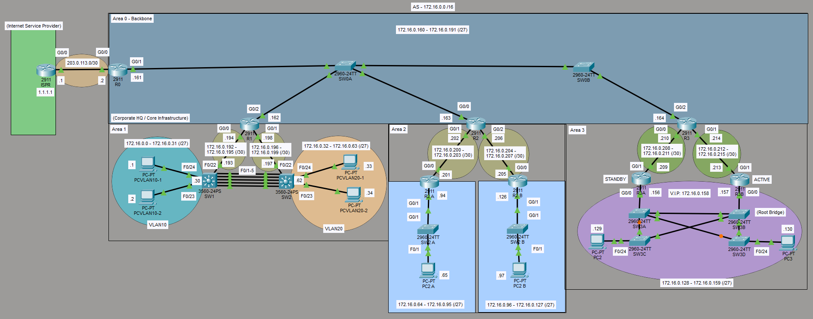

# **Multi-Area OSPF Lab – Single Autonomous System (AS 172.16.0.0/16)**

## Overview
This lab demonstrates a multi-area OSPF design in a single Autonomous System. Area 0 serves as the backbone, while non-backbone areas incorporate additional technologies: VLSM addressing, EtherChannel, HSRP, and manual Spanning Tree Protocol (STP) root bridge configuration.

The topology models a corporate network with an Internet edge, core infrastructure, and three downstream areas that each highlight different Layer 2 / Layer 3 features.

## Topology

## Topology Summary
- **Area 0 – Backbone**: Core routers and distribution switches interconnecting all areas.
- **Area 1**: Access layer with VLAN 10 and VLAN 20, Layer 3 switches, and EtherChannel between switches.
- **Area 2**: Dual routers (R2A / R2B) with separate /27 subnets and end devices.
- **Area 3**: HSRP pair (R3A standby / R3B active) with a four-switch Layer 2 domain, manual root bridge, and end devices.

Internet edge uses a simple /30 link to the ISP router.

## Key Design Elements
- **VLSM** throughout the 172.16.0.0/16 address space for efficient allocation of /27, /30, and other masks.
- **EtherChannel** between the 3560 switches in Area 1.
- **HSRP** in Area 3 (virtual IP 172.16.0.158) with explicit Active/Standby roles.
- **Manual STP root bridge** configuration on one of the switches in Area 3.
- Multi-area OSPF with Area 0 as the transit backbone.

## Important Observation – HSRP & STP Interaction
During testing it was observed that when the HSRP Active router fails and the Standby router takes over, the Spanning Tree topology does **not** automatically recalculate. This can introduce additional latency because the Layer 2 path remains suboptimal relative to the new Layer 3 first hop. Careful coordination of STP root placement and HSRP priorities is required in production designs that combine both protocols.

## Skills Demonstrated
- Multi-area OSPF configuration and inter-area routing
- VLSM addressing design
- EtherChannel (Layer 2 link aggregation)
- HSRP with Active/Standby roles
- Manual STP root bridge selection
- Awareness of the interaction between first-hop redundancy and Spanning Tree

## Current Status
Lab is fully operational in Packet Tracer.

## Files
- `multi-area-ospf.pkt` – Packet Tracer simulation file (current working state)
- `topology.png` – Network topology diagram
